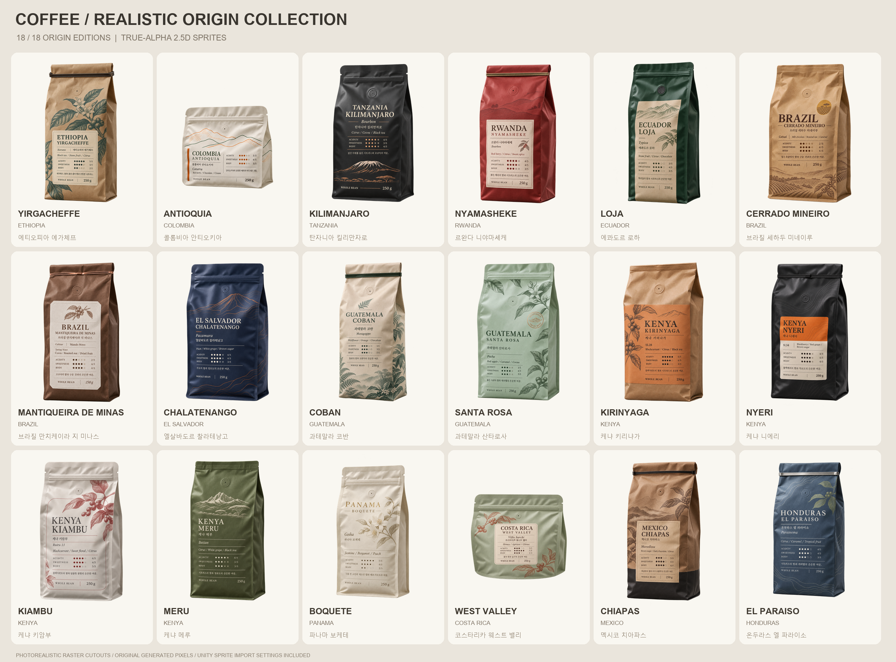
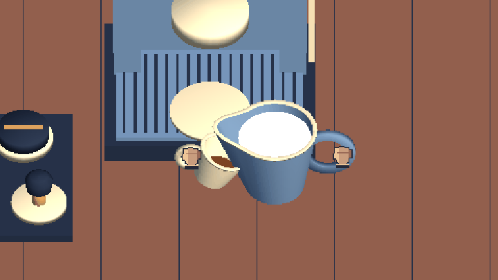

# Coffee

직접 원두를 갈고, 표면을 정리해 탬핑한 뒤 에스프레소를 추출하고 우유를 붓는 Unity 카페 게임입니다. 원본 커피 제작 프로젝트에 **사실적인 원두 봉투 18종**을 등록했습니다.



## 시작하기

Windows에서는 저장소 최상위의 **`OpenCoffeeProject.cmd`를 더블클릭**하면 설치된 Unity를 찾아 실제 카페 프로젝트를 엽니다. `FrontGrind` 씬에서 **상단 ▶ Play**를 누른 뒤 **B**로 원두를 선택하세요. 게임 카메라와 도구는 Play 시 생성됩니다.

창 제목이 `Project_Coffee - Untitled`이고 Assets에 `coffee_bags`, `coffee_bags_realistic`만 보인다면 상위 폴더를 빈 Unity 프로젝트로 연 상태입니다. Unity Hub에는 **`CloudCafeUnity/UnityProject`**를 등록해야 합니다. 기존 창이나 수정 중인 씬을 런처가 강제로 닫지는 않습니다.

1. 이 저장소를 내려받습니다.
2. Unity Hub에서 **`CloudCafeUnity/UnityProject`** 폴더를 추가합니다.
3. **Unity 6000.6.5f1**로 열고 패키지 가져오기가 끝날 때까지 기다립니다.
4. `Assets/Scenes/FrontGrind.unity`를 열고 Play합니다.
5. **B** 또는 **원두 선택** 버튼으로 봉투 사진·산지·향미를 확인하고 사용할 원두를 고릅니다. 원두 변경은 분쇄를 시작하기 전, 바스켓이 비어 있고 도구를 잡고 있지 않을 때 가능합니다.

별도 `.unitypackage`를 다시 가져올 필요 없이 이미지·카탈로그·원두 데이터가 프로젝트 안에 등록돼 있습니다.

## 커피 제작

**분쇄 → 표면 정리 → 탬핑 → 머신 삽입·잠금 → 컵 자리 맞춤 → 에스프레소 추출 → 우유 붓기**를 이어서 조작합니다.

| 조작 | 동작 |
| --- | --- |
| 마우스 드래그 | 포터필터·정리 도구·탬퍼·컵 이동 |
| 기계의 금색 버튼 / Space | 현재 단계의 분쇄·추출 또는 우유 붓기 |
| 우유 화면의 마우스 이동·휠 | 피처 위치·높이 조절 |
| B / 원두 선택 | 원두 18종 사진과 정보를 보고 선택 |
| D / 난이도 | 기본 또는 프로페셔널 선택 |
| Enter / 도징 확정 | 프로페셔널에서 바스켓에 담긴 분쇄량 확정 |
| R | 제작 다시 시작 |
| N | 우유 붓기 화면에서 새 커피 작업대로 돌아가기 |
| Esc | 선택창 닫기 또는 제작 일시 정지·마우스 해제 |

우유는 준비된 스팀 우유로 시작합니다. 실제 스티밍, 복잡한 라테 아트와 손님 제공은 후속 작업입니다.

### 프로페셔널 난이도

에스프레소 작업대 화면 상단의 **난이도** 버튼이나 **D**를 눌러 **기본** 또는 **프로페셔널**을 선택합니다. 기본 난이도는 처음 실행할 때 선택되어 있습니다. 에스프레소 작업 중이라면 **R**로 새 샷을 시작해 바스켓이 비고 도구가 제자리에 있을 때 난이도를 바꿀 수 있습니다.

1. 분쇄도 **1–9**, 추출수 온도 **90.5–96 °C**, 펌프 압력 **8.5–9.5 bar**를 설정합니다.
2. 포터필터를 그라인더에 맞추고 분쇄를 시작합니다. 원하는 양에 가까워지면 직접 멈추고 가루가 바스켓에 가라앉을 때까지 기다립니다. 포터필터를 작업 매트로 옮긴 뒤 **Enter** 또는 **도징 확정**을 누릅니다. **12–22 g** 범위에서 작업할 수 있고 기준 레시피는 **18 g**입니다.
3. 마우스로 분쇄 표면을 고르게 정리하고 수평으로 탬핑합니다. 탬핑 중 옆으로 밀면 물길이 일부에 집중되는 **채널링** 위험이 높아집니다.
4. 포터필터를 머신에 잠그고 컵을 놓습니다. 금색 버튼 또는 **Space**로 추출을 시작하고 저울과 타이머를 보면서 같은 조작으로 직접 종료합니다. 시작 레시피는 **18 g → 36 g(1:2), 25–30초, 93 °C, 9 bar**입니다.
5. 결과 화면에서 도징·추출액 무게·시간·추출 비율·채널링·점수와 피드백을 확인합니다. **TDS**는 컵 속 용존 고형분 농도, **EY**는 마른 원두에서 컵으로 녹아 나온 고형분의 비율입니다. 두 값은 게임이 추정하며, 결과 확인 후 우유 붓기로 이어가거나 새 샷을 시작할 수 있습니다.

기준 레시피와 점수 허용 범위는 게임용으로 조정했습니다. 추출 수율의 계산식은 `EY(%) = 추출액 무게(g) × TDS(%) ÷ 도징(g)`입니다. [Moroney 외, PLOS ONE, 2019](https://doi.org/10.1371/journal.pone.0219906)

- **레시피 기준**은 SCA와 Barista Guild의 현장 설문에서 참고했습니다. 응답의 평균 비율은 1:2였고, 가장 흔한 압력은 9 bar였습니다. [SCA 에스프레소 설문](https://sca.coffee/sca-news/25-magazine/issue-3/defining-ever-changing-espresso-25-magazine-issue-3-zyx36)
- **머신 설정 범위와 퍽 준비**는 WBC 경기 규정의 장비 온도·압력 범위와 균일한 분배·수평 탬핑 평가 항목을 참고했습니다. 경기에서는 펌프 압력이 고정되며, 게임에서는 직접 조절할 수 있습니다. [2024 WBC 공식 규정 §5.1, §14.2.4](https://sca-spain.coffee/wp-content/uploads/2025/01/2024-World-Barista-Championship-Official-Rules-and-Regulations.pdf)
- **분쇄와 채널링**은 너무 곱게 갈면 물이 불균일하게 흐르거나 일부가 막혀 수율이 떨어질 수 있다는 실험 결과를 반영합니다. [Cameron 외, Matter, 2020](https://doi.org/10.1016/j.matt.2019.12.019)
- **추출액 무게와 유량**은 컵에 담긴 총량이 성분량에 큰 영향을 주고, 실험에서 유량의 영향이 특히 컸다는 추출 실험을 참고했습니다. [Schmieder 외, Foods, 2023](https://doi.org/10.3390/foods12152871)

### 원본 제작 흐름 미리보기



위 GIF는 가져온 원본 프로젝트의 자동 조작 기록입니다. 이번 원두 등록 변경의 실제 마우스 입력 검증 영상은 아닙니다.

## 원두 에셋 등록

- **이미지:** 사실적인 고정 시점의 **1024 × 1536 투명 PNG 18종**. 크라프트지·무광 필름, 자연스러운 주름, 틴 타이·지퍼·봉합선과 산지별 인쇄를 표현했습니다.
- **Unity 등록:** PNG의 Sprite 설정, 원두별 `CoffeeBeanDefinition` 18개와 전체 `CoffeeBeanCatalog`를 `.meta`와 함께 포함합니다.
- **게임 연결:** `Resources/CoffeeBags/CoffeeBeanCatalog`를 읽어 실제 봉투 사진과 산지·품종·향미·산미·단맛·바디·설명을 표시합니다.
- **표현 범위:** 사진처럼 보이는 2.5D 스프라이트입니다. 자유 회전하는 3D 메시나 새 PBR 재질 세트는 포함하지 않습니다.
- **향미:** 1~5 지표는 산지 자료를 참고한 대략적인 게임용 프로필입니다. 실제 맛은 로트·가공·로스팅에 따라 달라지며 현재 분쇄·추출 물리 수치를 변경하지 않습니다.

원본 PNG와 프롬프트·출처·별도 Unity 패키지는 [`assets/coffee_bags_realistic`](assets/coffee_bags_realistic/)에서 확인할 수 있습니다. 이전 카툰 시안은 작업 PC에 보존하고 이 저장소에서는 제외했습니다.

## 등록된 산지 18종

| 국가 · 산지 | 품종 | 대표 향미 | 산미 / 단맛 / 바디 |
| --- | --- | --- | --- |
| 에티오피아 예가체프 | Kurume | 홍차 · 핵과일 · 시트러스 | 5 / 4 / 2 |
| 콜롬비아 안티오키아 | Caturra | 붉은 베리 · 초콜릿 · 크림 | 3 / 4 / 3 |
| 탄자니아 킬리만자로 | Bourbon | 시트러스 · 코코아 · 홍차 | 4 / 3 / 4 |
| 르완다 니야마셰케 | Bourbon | 붉은 베리 · 시트러스 · 달콤한 향신료 | 4 / 4 / 3 |
| 에콰도르 로하 | Typica | 핵과일 · 시트러스 · 초콜릿 | 3 / 4 / 3 |
| 브라질 세하두 미네이루 | Catuai | 밀크 초콜릿 · 구운 견과 · 캐러멜 | 2 / 4 / 4 |
| 브라질 만치케이라 지 미나스 | Mundo Novo | 코코아 · 구운 견과 · 말린 과일 | 2 / 4 / 4 |
| 엘살바도르 찰라테낭고 | Pacamara | 자두 · 청포도 · 흑설탕 | 4 / 4 / 3 |
| 과테말라 코반 | Maragogipe | 들꽃 · 오렌지 · 초콜릿 | 3 / 3 / 3 |
| 과테말라 산타로사 | Pache | 붉은 사과 · 캐러멜 · 코코아 | 3 / 4 / 3 |
| 케냐 키리냐가 | SL28 | 블랙커런트 · 시트러스 · 홍차 | 5 / 4 / 3 |
| 케냐 니에리 | SL34 | 블랙베리 · 적포도 · 흑설탕 | 4 / 4 / 4 |
| 케냐 키암부 | Ruiru 11 | 블랙커런트 · 달콤한 꽃향 · 시트러스 | 4 / 4 / 3 |
| 케냐 메루 | Batian | 시트러스 · 청포도 · 홍차 | 4 / 3 / 3 |
| 파나마 보케테 | Gesha | 재스민 · 베르가모트 · 복숭아 | 5 / 4 / 2 |
| 코스타리카 웨스트 밸리 | Villa Sarchi | 꿀 · 살구 · 시트러스 | 3 / 5 / 3 |
| 멕시코 치아파스 | Marsellesa | 흑설탕 · 다크 초콜릿 · 시트러스 | 3 / 4 / 4 |
| 온두라스 엘 파라이소 | Parainema | 시트러스 · 캐러멜 · 열대과일 | 4 / 4 / 3 |

모든 지표는 5점 기준의 게임용 상대 프로필입니다. 각 재배 조합의 근거와 가공·로스팅 선택은 [원두 원본 데이터](assets/coffee_bags_realistic/catalog/products.json)에 담았습니다.

## 프로젝트 구성

| 경로 | 내용 |
| --- | --- |
| [`CloudCafeUnity/UnityProject`](CloudCafeUnity/UnityProject/) | Unity에서 여는 카페 게임 |
| [`Assets/Scenes/FrontGrind.unity`](CloudCafeUnity/UnityProject/Assets/Scenes/FrontGrind.unity) | 전체 제작 과정의 시작 씬 |
| [`Assets/Scripts/Crafting`](CloudCafeUnity/UnityProject/Assets/Scripts/Crafting/) | 분쇄·탬핑·추출·우유 조작과 원두 선택 |
| [`Assets/Scripts/Coffee`](CloudCafeUnity/UnityProject/Assets/Scripts/Coffee/) | 원두 카탈로그·정의 |
| [`Assets/Resources/CoffeeBags`](CloudCafeUnity/UnityProject/Assets/Resources/CoffeeBags/) | 등록된 봉투 이미지·원두 18개·카탈로그·원본 정보 |
| [`assets/coffee_bags_realistic`](assets/coffee_bags_realistic/) | 최종 원본 이미지, 프롬프트, 미리보기, `.unitypackage` |
| [`CloudCafeUnity/Tests`](CloudCafeUnity/Tests/) | 기존 커피 제작 모델 회귀 테스트 |
| [`tools`](tools/) | 에셋 재등록 및 검증 도구 |
| [`docs/SOURCE_IMPORT.md`](docs/SOURCE_IMPORT.md) | 원본 브랜치·커밋 및 가져오기 범위 |

## 원본과 검증 범위

[SDHQN의 `coffee-crafting-20261103` 브랜치](https://github.com/blueanggel10004-tech/SDHQN/tree/coffee-crafting-20261103)의 커밋 [`76d52d0`](https://github.com/blueanggel10004-tech/SDHQN/commit/76d52d0db9cbea0084a4ac480a96df566d5aff9f)에서 독립 카페 프로젝트 `CloudCafeUnity/` 전체를 가져왔습니다. 목적지 저장소의 기존 `main` 이력을 보존했습니다.

원본의 Unity `.meta`, DOTween 및 FluidSim 파일과 관련 라이선스, 패키지·프로젝트 설정, 작업 문서와 테스트를 함께 보존합니다. Unity 버전은 원본 `ProjectVersion.txt`를 따릅니다.

이번 변경의 재현 가능한 검증은 다음 명령으로 실행합니다.

```powershell
pwsh -NoProfile -File tools/test_coffee_project.ps1
python tools/register_coffee_assets.py --validate-only
```

기존 제작 모델 8개 테스트 프로그램의 518개 항목과 PNG·Unity 원두 데이터 18종의 참조·GUID·원본 해시 검사를 수행합니다. 결과는 [`tools/validation.json`](tools/validation.json)에 저장합니다.

이번 작업에서 **Unity 6000.6.5f1 실제 컴파일, 18종 Resources 로드, Windows 빌드, 전체 제작 흐름·우유 연습·원두 선택 API 자동 실행**을 확인했습니다. 새 결과는 [`Review/CoffeeAssets`](CloudCafeUnity/Review/CoffeeAssets/)에 모았습니다. 원두 선택 검사에는 기본 예가체프, 안티오키아·킬리만자로 선택, 잘못된 ID·중간 투입 변경 차단, 커서 복구가 포함됩니다.

```powershell
# 로컬 Unity 설치 경로를 지정해 Windows 실행본 생성
./CloudCafeUnity/BuildCoffeeCraft.ps1 -UnityEditor 'E:/6000.6.5f1/Editor/Unity.exe'
# 빌드된 게임의 런타임 API 및 기존 제작 흐름 검사
./tools/run_coffee_smoke.ps1 -Mode coffeeBeanSmoke -SkipCapture
./tools/run_coffee_smoke.ps1 -Mode frontSmoke
./tools/run_coffee_smoke.ps1 -Mode latteSmoke
```

실제 OS 마우스·키보드 입력 인수와 원두 선택창의 시각 캡처는 미완료입니다. 숨긴 창에서 캡처가 검게 나오는 환경이어서 원두 선택 API 검사와 화면 검사를 분리했습니다. `-SkipCapture`를 생략하면 검은 화면을 실패로 판정합니다. README의 봉투 이미지는 생성 원본 갤러리이고, 위 GIF와 기존 `Review` 결과는 가져온 원본 프로젝트의 기록입니다.
